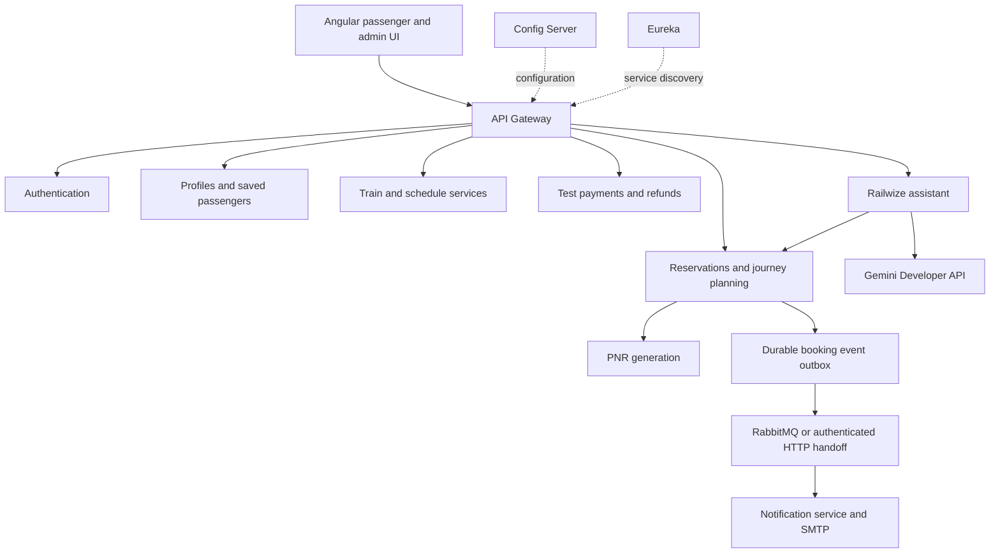

# Railwize

### Railway reservations with connecting-train and nearby-station discovery

I built **Railwize** to bring train discovery, reservations, payment tracking and journey updates into one application. My main focus is helping passengers find a practical journey when an exact direct train is unavailable: the platform can suggest a connection through an interchange or a train from a nearby departure station to a nearby destination.

The project combines an **Angular frontend** with **12 Spring Boot services**. It includes passenger accounts, an administrator workspace, confirmed and waitlisted bookings, Razorpay test checkout, refunds, ticket PDFs, email and in-app notifications, and a Gemini-powered travel assistant.

**Project scope:** payments and refunds use Razorpay **test mode**. Railwize manages its own train catalogue and reservation inventory; it is not connected to Indian Railways' live reservation system.

## Documentation

| Guide | Contents |
| --- | --- |
| [Backend README](backend/README.md) | Services, databases, business rules, security, environment configuration, APIs and tests |
| [Frontend README](frontend/README.md) | Passenger/admin screens, routes, authentication, browser storage, setup and UI tests |
| [India dataset guide](Railwize-india-data/INDIA-DATA-GUIDE.txt) | All sample stations/trains/timetables and feature demonstration steps |
| [India SQL dataset](Railwize-india-data/LOAD-INDIA-CATALOGUE.sql) | Catalogue, operating days, capacity, fares and schedules |
| [Additional QA dataset](Railwize-test-data/README.md) | Synthetic routes for targeted boundary checks |

## The problem I wanted to solve

A passenger may find no suitable direct train between two selected stations even when a usable journey exists. Finding that journey manually means checking nearby terminals, identifying an interchange, comparing arrival and departure times, and checking availability on each train.

Railwize brings those checks together:

1. Search the exact stations for direct trains.
2. Explore journeys with **one same-station interchange**.
3. Optionally include stations near the requested origin and destination.
4. Compare actual stations, boarding dates, transfer time, class availability and fares.
5. Review the itinerary and book each leg through the normal reservation flow.

For example, the demonstration dataset has no direct **NZM → BSB** sleeper service. It can suggest **NZM → LJN** followed by **LJN → BSB**, with a 90-minute transfer. A **CSMT → ADI** search can also suggest a departure from **Bandra Terminus** and arrival at **Sabarmati** when nearby search is enabled.

These are timetable-based suggestions. Each leg has its own booking, payment and PNR; local transport and protection against missed connections are not included.

## Passenger features

| Feature | What the passenger can do |
| --- | --- |
| Registration and verification | Create an account, verify an email OTP, resend a code and receive a welcome email |
| Sign-in and recovery | Use credentials or Google sign-in, reset a local-account password, and log out of one or all sessions |
| Account details | View/update personal details, see the verified account email, and make one display/login username change |
| Train discovery | Search by boarding station, destination, date, class and 1–6 passengers |
| Journey alternatives | Compare connecting trains and nearby-station options with transfer times and per-leg fares |
| Recent searches | Reuse the five most recent valid searches, stored separately for each signed-in account in the browser |
| Saved passengers | Maintain a personal Master List and select passengers while booking |
| Fare review | See a server-calculated fare based on journey distance and class pricing before reserving |
| Reservation | Create a two-minute payment hold with whole-booking CNF or WL allocation |
| Test checkout | Pay through Razorpay test checkout and track verified payment status |
| Waitlist | Pay for a WL booking and receive automatic confirmation when the complete booking fits |
| Ticket details | View PNR, journey, payment/refund state and class-specific coach/seat/berth descriptions |
| Ticket PDF | Download an authenticated, branded PDF with passenger, fare and current booking information |
| Cancellation | Review the cancellation estimate, cancel the whole booking and follow the test refund |
| Journey history | Filter, sort and paginate bookings by status and journey dates |
| Calendar reminder | Download an `.ics` reminder for a future confirmed journey |
| Notifications | Read booking, payment, waitlist, cancellation and refund updates in the notification centre |
| Travel assistant | Ask policy questions, search trains, inspect an owned PNR, list bookings/cancellations and ask about the next journey |
| Help centre | Search categorized guidance about accounts, booking, payments, waitlists and cancellations |

## Administrator features

Administrators use the same sign-in page and enter the **Admin workspace** after login. Public registration cannot select the ADMIN role.

| Area | Capabilities |
| --- | --- |
| Dashboard | Account, train, booking and cancellation counts; booking-status breakdown; fare/refund summaries |
| Popular trains | Top trains ranked by verified paid booking count |
| Stations | Create/edit station information and coordinates used for nearby search |
| Trains | Configure train identity, endpoints, operating days, classes, capacity and fare parameters |
| Timetables | Publish ordered stops, cumulative distance, arrival/departure times and overnight day numbers |
| Users | Search/filter accounts, view profile and booking history, block/reactivate eligible passenger accounts |
| Bookings | Search by PNR/account/email, filter by train/status/journey date, and review or cancel bookings |
| Revenue and cancellations | Group reports by journey day, month or train, with cancellation rates and refund totals |
| Exports | Download user, booking, cancellation and financial reports as Excel-compatible CSV |
| Dated train cancellation | Preview and cancel one future source-date run, notify affected passengers and refund captured fares in full |
| Admin invitations | Invite a verified account, inspect invitation history and revoke unused invitations |

Train-run cancellation preserves the train and historical records. It cancels a **specific source departure date**, across all classes and boarding segments, while other dates remain available.

## Important booking rules

I kept allocation predictable by using **CNF and WL only**, without RAC or mixed passenger statuses inside one booking.

- A booking contains **1–6 passengers**, all on one train run, class and journey segment.
- Boarding dates must be from today through **two calendar months ahead**, inclusive, in IST. Boarding time must still be in the future.
- The payment hold lasts **two minutes**, or less if a relevant departure/cutoff is reached.
- A verified captured payment activates the booking. Payment success alone does not mean a WL ticket is confirmed.
- Paid WL bookings promote automatically in creation order. The whole booking must fit; later smaller bookings do not bypass the first eligible queue entry.
- Remaining WL bookings close **one hour before their boarding departure** by default and receive full test refunds.
- A passenger's confirmed cancellation normally deducts the configured fee, **20% by default**. Paid WL cancellations have no deduction.
- An operator's dated train cancellation gives a **full test refund with no cancellation deduction** for affected paid bookings.
- Capacity is shared across overlapping route segments. A berth can be reused on a later, non-overlapping segment of the same run.

Detailed lifecycle, concurrency and refund rules are in the [backend guide](backend/README.md).

## How the application works



An administrator first publishes the catalogue and timetable. A passenger searches, obtains a quote and creates a booking hold. Payment-service verifies the test payment, reservation-service updates the booking, and lifecycle events drive emails and in-app updates. Payment/refund reconciliation continues independently of the browser.

Each data-owning service has its own MySQL schema. Eureka provides service discovery, Config Server supplies shared configuration, and the gateway is the browser-facing API entry point.

## Technology

| Layer | Technologies used in this repository |
| --- | --- |
| Frontend | Angular 21, TypeScript, standalone components, signals, RxJS, Angular Router, CSS |
| Backend | Java 21 source level, Spring Boot 4.1.1, Spring Cloud, Spring Security, Spring Data JPA, Bean Validation |
| Service communication | Spring Cloud Gateway, Eureka, Config Server, OpenFeign, HTTP clients |
| Storage and messaging | MySQL 8, RabbitMQ, service-owned databases |
| Authentication | JWT access/refresh sessions, BCrypt, Google OAuth |
| Payments | Razorpay test orders, signature verification, reconciliation and refunds |
| Documents and mail | Apache PDFBox, bundled fonts, branded HTML emails, SMTP |
| Assistant | Spring AI, Gemini Developer API, WebFlux/SSE, SimpleVectorStore, in-memory memory/cache |
| Reliability | Database locking, idempotency, event outbox/inbox, Resilience4j, SLF4J/Logback |
| Testing | JUnit, Mockito, H2-backed integration tests, Jasmine and Playwright scenarios |

The application runs with native local services. Docker Desktop, WSL and Redis are not required. SonarQube integration is a future improvement.

## Repository structure

```text
Railwize/
├── README.md
├── backend/                 # 12 services, configuration, SQL and launch/test helpers
├── frontend/                # Angular application and frontend tests
├── Railwize-india-data/      # 60 stations, 27 trains, 165 timetable stops and guide
└── Railwize-test-data/       # Additional synthetic QA catalogue and request examples
```

## Run locally

### 1. Prerequisites

Install JDK 21 or a compatible newer JDK, Maven 3.9+, MySQL 8, native RabbitMQ with a compatible Erlang runtime, and Node.js matching [frontend/package.json](frontend/package.json). Node 22.13+ within the 22.x line is a suitable project setup. PowerShell 7 is needed only for the optional `.ps1` helpers.

Extract the repository fully if using **Code → Download ZIP**. MySQL records, private `.env` values and generated dependencies are not included in a source ZIP.

### 2. Configure the backend

1. Start MySQL and RabbitMQ.
2. Execute [backend/Create-Databases.sql](backend/Create-Databases.sql).
3. Create `backend/.env` from [backend/.env.example](backend/.env.example), or use `New-DevEnvironment.ps1` to generate local service secrets.
4. Fill database, SMTP, Google, Razorpay test and Gemini settings. Keep the file private.
5. Leave `PDF_FONT_PATH` empty to use the bundled fonts.
6. Follow the [backend startup instructions](backend/README.md#running-the-services), including the IDE/CMD options if unsigned PowerShell scripts are blocked.

Start Config Server on **8888** and Eureka on **8761** first, then application services and the gateway on **8080**. Config Server/Eureka use infrastructure credentials from the environment, not a passenger account.

For a fresh installation, enable the configured bootstrap admin once, create that account, then disable bootstrap. Further administrators join through invitations.

### 3. Start Angular

From `frontend/`, run these in CMD or a terminal:

```text
npm ci
npm start
```

Open **http://localhost:4200**. The development proxy sends `/api` requests to the gateway. The frontend does not need provider secrets.

### 4. Load a demonstration catalogue

Start the current train/schedule services once so the tables exist, then stop the application services and execute [LOAD-INDIA-CATALOGUE.sql](Railwize-india-data/LOAD-INDIA-CATALOGUE.sql) as a complete script in MySQL Workbench. Restart the services afterward.

The dataset contains **60 stations, 20 researched Indian train services, 7 fictional test services and 165 stops**. Sample capacities/fares and approximate coordinates make it useful for demonstrations; it is not a live timetable feed. Existing station records are preserved, and conflicting train/timetable numbers abort the import. Read the [dataset guide](Railwize-india-data/INDIA-DATA-GUIDE.txt) before loading.

### Local entry points

| Address | Purpose |
| --- | --- |
| `http://localhost:4200` | Passenger application |
| `http://localhost:4200/admin` | Authorized admin workspace |
| `http://localhost:4200/help` | Help centre |
| `http://localhost:4200/assistant` | Signed-in assistant page |
| `http://localhost:8080/swagger-ui/index.html` | Shared API documentation/testing |
| `http://localhost:8761` | Secured Eureka dashboard |

## Testing and demonstration

Run `mvn test` inside an individual backend service, or `Verify-Backend.ps1` from `backend/` for the service suites. From `frontend/`, use:

```text
npm test
npm run build
npm run test:e2e
```

JUnit/Mockito and isolated integration tests exercise backend rules. Jasmine tests frontend logic/services; Playwright scenarios exercise browser flows using controlled responses. These are separate from live checks of Google, SMTP, RabbitMQ, Gemini and Razorpay test checkout. Detailed commands and test boundaries are documented in the component READMEs.

My suggested evaluation flow is:

1. Register, verify email, sign in and save passengers.
2. Search a direct train and explain the distance-based fare.
3. Demonstrate an interchange and a nearby-station alternative.
4. Complete a test booking and show the ticket, PDF, email, notification and calendar reminder.
5. Fill the two-seat `RW907` service, create a paid WL booking, and cancel a confirmed booking to demonstrate promotion.
6. Cancel a different dated run as admin and show full-refund processing.
7. Review user management, popular trains, reports and CSV exports.
8. Ask the assistant about a policy, the account's bookings and its next journey.

## Design decisions and current boundaries

- **Trust stays in the backend.** The UI helps validate forms, but fares, ownership, permissions, payment verification and allocation are checked by services.
- **Whole-booking allocation simplifies payment and refunds.** There is no RAC, split CNF/WL group or individual-passenger cancellation.
- **Connections are independent tickets.** Planning does not hold both trains together or guarantee an onward connection.
- **Nearby search estimates distance.** It uses coordinates, not road routing, platform walking time or live transport conditions.
- **Reports describe test bookings.** Financial figures are grouped by journey date and are not a payment-provider settlement ledger. Exports are CSV, not native XLSX.
- **The assistant is read-only.** It cannot make bookings, charge money, cancel tickets or change accounts. Provider availability and quota affect AI replies.
- **Assistant state is local to its process.** Conversations, vector index and semantic cache are in memory and reset when the chatbot service restarts.
- **Operational boundaries are explicit.** Dated run cancellation is permanent and must occur before source departure; diversion, partial-route cancellation and reinstatement are not implemented.

## Moving the project to another laptop

Use a fresh clone/ZIP and install the prerequisites. Transfer `.env` privately and update machine-specific values. To preserve existing accounts and bookings, stop the application services and export all eight MySQL schemas together, then import that snapshot into the other laptop. For a fresh demonstration, create empty schemas and load a sample catalogue instead.

Do not commit credentials, database exports containing personal data, runtime logs, `node_modules`, Maven `target` folders or generated build/test reports. Dependencies can be restored from Maven and `package-lock.json`; fonts, templates, test source and catalogue SQL are included in the repository.
