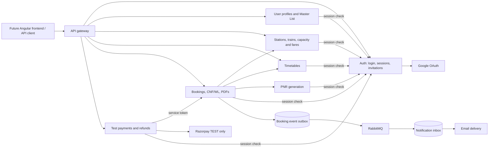
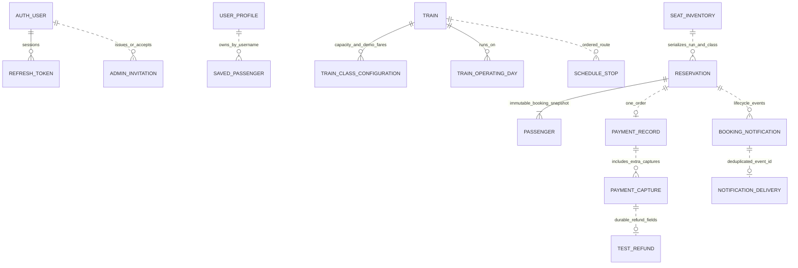

# Railway demo architecture

Each business service owns its MySQL database. Services communicate over HTTP and discovery; booking notifications use RabbitMQ. The test suite substitutes H2 and mocked external dependencies. The diagrams describe the design, not a claim that a complete deployed system was exercised.



Config Server supplies environment-based configuration; Eureka supplies discovery. The auth session-check URL and payment-to-reservation URL are explicitly configurable for local deployment. Internal service-token endpoints are excluded from gateway routes. Public catalogue reads remain available without a JWT; protected business operations validate JWT signatures, current sessions and roles/ownership.

## Booking/payment sequence

```mermaid
sequenceDiagram
    participant U as User
    participant R as Reservation
    participant P as Payment
    participant T as Razorpay test
    participant N as Notification
    U->>R: Quote and book whole group
    R->>R: Lock inventory; expire/promote due bookings
    R-->>U: PNR, proposed CNF/WL, two-minute deadline
    U->>P: Create order for PNR
    P->>R: Read saved fare and payment eligibility
    P->>T: Create/recover test order
    P-->>U: Test checkout details
    U->>T: Complete test checkout
    U->>P: Verify signed checkout result
    P->>T: Fetch/validate captured payment
    P->>R: Confirm verified amount
    R->>R: Activate whole CNF or paid WL; persist email event
    R-->>P: Current booking status or refund decision
    R-->>N: Durable payment/status notification
    Note over R: Seat release triggers FIFO WL promotion under the same lock
    R-->>N: Promoted CNF with seats
    Note over R: Remaining WL at cutoff is cancelled with full refund due
    P->>R: Scheduled reconciliation
    P->>T: Recover/create idempotent test refund
    P->>R: Refund status update
    R-->>N: Refund initiated/completed
```

The checkout callback is not the only recovery mechanism. Signed webhooks are persisted, and the payment worker retries interrupted operations. Provider calls occur outside payment-store database transactions. Refund receipts/capture records prevent duplicate financial operations. All amounts use decimal INR snapshots; clients cannot set payable amounts.

## Main database relationships



Dotted links are logical references; databases do not share foreign keys. Refund fields live in `payment_captures` rather than a separate `TEST_REFUND` table. Train timetable references and saved-passenger ownership use stable train numbers/usernames. Bookings copy passenger and fare data rather than depending on mutable master records.

## Evaluation talking points

- Whole-booking FIFO is deliberately simple: no RAC, mixed passenger statuses, partial cancellations or queue bypass. A large queue head can leave seats unused.
- The boarding-date window is today through two calendar months ahead (inclusive, India time). Station-code normalization is applied before API validation/booking fingerprints. Passenger entries cannot be null, and booking/Master List berth preferences use the same allowed values.
- Inventory locks and READ_COMMITTED write transactions protect booking/promotion/cancellation against concurrent changes. H2 concurrency tests exercise the logic; MySQL lock behaviour is not claimed as externally verified.
- CNF/WL is separate from payment success, checkout expiry and refund completion. A paid WL booking is not a confirmed seat.
- Logout is enforced server-side on subsequent requests. Session checks add an auth-service dependency; protected requests fail closed when it is unavailable.
- Error responses use a common contract and request IDs. The services currently include equivalent small error-support classes to keep each Maven project independently buildable; a shared library could be extracted later.
- Outbox/inbox persistence prevents normal lost/duplicate events. SMTP delivery cannot be exactly-once across every crash window, and exhausted retries remain visible in database records.
- Credentials come from environment settings, admin accounts cannot be self-selected, and every checkout/refund is test-only.
- Refer to `VALIDATION.md` for actual tests and limitations. No live Google/RabbitMQ/Razorpay acceptance or full end-to-end test is claimed.
- `Verify-Backend.ps1 -Integration` runs the selected integration suites. Reservation HTTP tests use a real embedded server, real Feign/session-check HTTP clients and H2, with local stubs for other services. Catalogue, timetable, Master List and payment API integration tests exercise real local business logic and repositories through MockMvc. External providers remain controlled test doubles.
